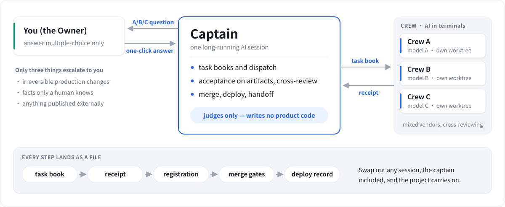
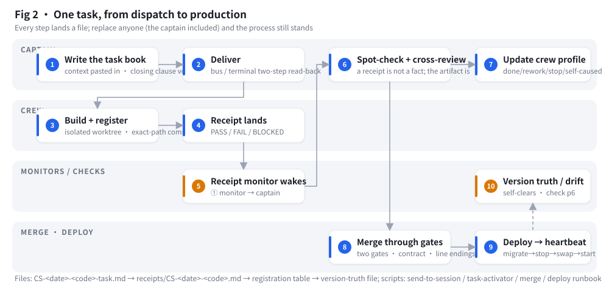

# StarFix

**One AI acts as captain and runs a crew of terminal AI agents until the project is done.**

Dispatch, acceptance, merge, deploy, handoff: every step lands as a file. It runs for weeks, and any session can be replaced without losing the thread.

[中文](README.md) · [English](README.en.md) · [How it works](docs/mechanism.en.md) · [Benchmark](#benchmark) · [Operating rules](skill/SKILL.en.md)

<picture>
  <source media="(prefers-color-scheme: dark)" srcset="docs/img/en/dark/hero.svg">
  
</picture>

## The problem

Letting one AI spawn its own sub-agents works for tasks that take minutes. A project that runs for weeks, on several lines at once, across more than one model, runs into three problems:

- **It does not last.** A sub-agent ends with its parent's turn, so it cannot carry a two-to-three-hour development task. Once the parent's context is compacted, the process is gone.
- **Nobody checks the work.** The same model writes and reviews. Conclusions survive only as a paraphrase, with no artifact to go back to.
- **A human cannot take over.** You cannot see what it is doing, and you cannot step in when it goes wrong.

This project replaces a series of calls with a team that has roles and records:

| | An AI spawning sub-agents | StarFix |
|---|---|---|
| Who does the work | Short-lived sub-tasks sharing the parent's context | Long-lived terminal sessions, each with its own context, worktree and quota |
| Models | Only the parent's | Mixed vendors: one writes, another reviews |
| Where the facts live | The parent's paraphrase | Task books, receipts and registrations, all files |
| Human takeover | Invisible | Every crew member is a terminal window you can watch and interrupt |
| Who manages | Whoever is also doing the work | The captain only judges and writes no product code |

The cost should be stated too. This needs infrastructure: terminal automation, monitors and a task activator. Getting started costs an order of magnitude more than spawning one sub-agent. For a single-line project that takes less than a day on one model, sub-agents are enough. The full comparison is in [docs/why.en.md](docs/why.en.md).

## Four terms

- **Captain**: one long-running AI session. It only judges: it writes task books, dispatches, accepts work, merges, deploys and talks to stakeholders.
- **Crew member**: another AI session in a terminal, possibly a model from a different vendor. Each task is built in its own worktree and ends with a receipt.
- **Receipt**: the file a crew member hands back, stating PASS, FAIL or BLOCKED, with evidence. The captain checks the artifact (the commit, the data, the run result), not what the receipt says.
- **Owner**: the person who owns the project. Only three kinds of matter escalate to the Owner: irreversible production changes, facts only a human knows, and anything published externally. Each arrives as a multiple-choice question with a recommended option, and one click unblocks the tasks behind it.

Every term used in this repository is listed in [docs/glossary.md](docs/glossary.md).

## How one task gets done

<picture>
  <source media="(prefers-color-scheme: dark)" srcset="docs/img/en/dark/02-task-lifecycle.svg">
  
</picture>

The captain writes a task book and delivers it to a crew member's terminal. The crew member builds in an isolated worktree, registers the change and hands back a receipt. A monitor sees the receipt and wakes the captain. The captain spot-checks the artifact, sends it to another model for cross-review, and merges and deploys only after it passes the gates. The files each step leaves behind, and the scripts involved, are in [docs/mechanism.en.md](docs/mechanism.en.md).

## Trajectory Compiler: let a machine re-check the process

A receipt that was never registered, a registration that was never merged, a merge that was never deployed: none of these is a code error, yet they are what a crew of AI agents gets wrong most often. The Trajectory Compiler turns the steps a human takes to audit one task into a graph. Stable verdict points are decided by scripts, and only the uncertain branches go to a model.

| Process audit per task | Before compiling | After compiling |
|---|---|---|
| Model cost | about 12,000 tokens | 0 calls |
| Time | minutes | 0.6 seconds |

These figures were measured for routine tasks on one real audit workflow. Across 48 runs, no wrong verdict went unreported. Exception branches still go back to the model. How it works, and what it costs, is in [docs/trajectory.en.md](docs/trajectory.en.md).

## Benchmark

Whether a model can serve as captain can be tested. The repository includes an exam, captain-v1: 157 checkpoints in four layers (judgment questions, sandbox operation, continuous watch, taking over a handoff), with nine abilities scored separately.

| Model | Environment | Overall | Result |
|---|---|---:|---|
| GPT-6 Astra | Codex CLI 0.153.4 | 85.6 | not passed |
| grok-4.6 | Grok CLI 1.0.25 | 82.2 | not passed |
| DeepSeek V4.1 Flash | Grok CLI 1.0.25 | 76.2 | not passed |

Passing requires an overall score of at least 90, role discipline of at least 95, and at least 85 on every other ability. None of the three models passes yet. The scores of the first two were recalibrated once for a simulator false rejection; the raw scores are kept in the records.

[Interactive results](https://marcmao0819.github.io/starfix/bench/) · [Question bank and scoring](benchmarks/captain-v1/README.md) · [Raw records](benchmarks/captain-v1/results/records/)

## What is in the repository

| Directory | Contents |
|---|---|
| [skill/](skill/SKILL.en.md) | The captain's operating rules: first actions on taking office, red lines, decision boundaries, task books, dispatch, acceptance, merge and deploy, away mode, handoff |
| [doctrine/](doctrine/00-README.en.md) | Command doctrine, case files, pitfalls, and how a captain is assessed |
| [specs/](specs/) | Specifications for each mechanism: monitors, terminal delivery, task activator, away mode, memory, context handoff, fleet recovery |
| [scripts/](scripts/README-env.en.md) | Supporting scripts: task activator, terminal delivery, sentinels and watchdogs, ask panel, message relay, context steward, fleet recovery |
| [templates/](templates/) | Templates for task books, receipts, handoff cards, crew profiles and stakeholder profiles |
| [trajectory/](trajectory/) | The Trajectory Compiler's inducer, runner and contract |
| [benchmarks/](benchmarks/captain-v1/README.md) | The captain exam: question bank, scoring method and the records of three models |
| [adapters/](adapters/) | Adapters for other terminal AI tools; opencode so far |
| [docs/](docs/mechanism.en.md) | How it works, design trade-offs, and the bilingual glossary |

## Getting it running

This is not a framework you install and run. It is a set of operating rules with supporting scripts that you connect to the terminal AI tools you already use.

1. Give [skill/SKILL.en.md](skill/SKILL.en.md) to the session that will be captain. Section 1 lists the first actions on taking office; done in order, they take about ten minutes.
2. Set the environment variables described in [scripts/README-env.en.md](scripts/README-env.en.md). `FLEET_HOME` is required and has no default.
3. Run `scripts/terminal-probe.sh` to see which delivery channels your terminal supports, then read [specs/delivery-terminal.en.md](specs/delivery-terminal.en.md). iTerm2 has a reference implementation; other terminals follow the specification.
4. Start with one task: write a task book from [templates/01-任务书.en.md](templates/01-任务书.en.md), dispatch it to one crew member, wait for the receipt, and check the artifact.

## Six principles

1. The captain only judges and writes no product code. A crew member failing is normal; the captain's own mistake is the incident.
2. A receipt is not a fact; the artifact is. Every criterion must be able to answer "when would this fail?".
3. Stop and ask the Owner in three cases only: irreversible production changes, facts only a human knows, and anything published externally.
4. Every question waiting on a person goes into the decision panel, and an answer unblocks the task.
5. Monitors report only the dangerous side and only state transitions. They do not poll.
6. A lesson becomes a case file and a gate the same day. Left overnight, it is lost.

## Who it is for

- **Forward-deployed engineers.** One person running a crew of AI agents on several lines at a customer's site, who has to dispatch, accept work, talk to each role, put decisions in front of the customer's Owner, leave a record that can be checked, and hand off at any time.
- **Independent developers and technical leads of small teams** who want several AI sessions to work together for a long time without losing control.

A single-line task that finishes within a day does not need it.

## Contributing

Run `tools/scrub-gate.sh` before you commit. It blocks personal names, addresses, identifiers and similar content that does not belong in a public repository.

## Author and licence

**三娃老爸** (GitHub [MarcMao0819](https://github.com/MarcMao0819); Xiaohongshu "三娃老爸", ID 294613559). The mechanism, the rules and every ruling behind them were set by him on a real project. Organising, scrubbing, drawing and committing were done by AI sessions under his command. Questions are welcome on Xiaohongshu.

Released under the MIT licence; see [LICENSE](LICENSE).
