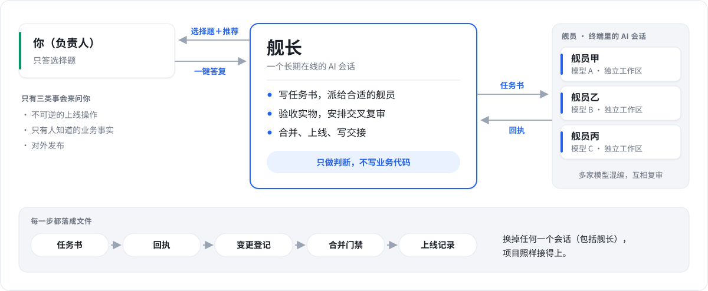
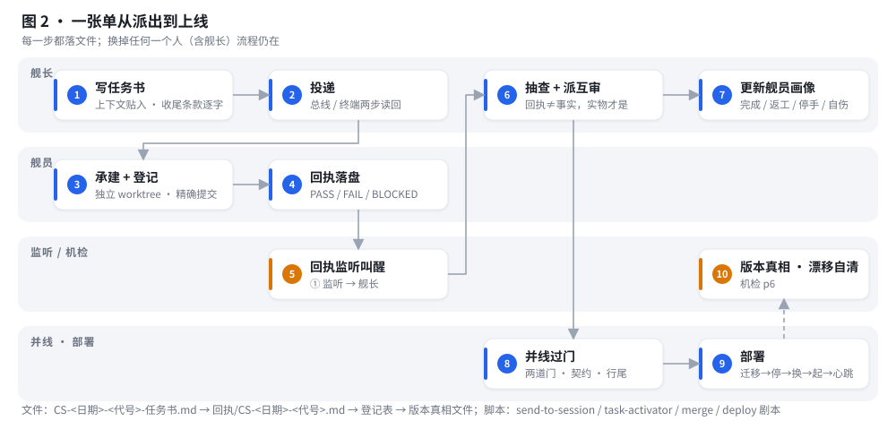

# Multi-Agent-Commander

**一个 AI 当舰长，指挥一队终端里的 AI 把项目做完。**

派单、验收、合并、上线、交接，每一步都落成文件。连续跑几周，换掉哪个会话都接得上。

[中文](README.md) · [English](README.en.md) · [工作机制](docs/mechanism.md) · [评测](#评测) · [规程](skill/SKILL.md)

<picture>
  <source media="(prefers-color-scheme: dark)" srcset="docs/img/dark/hero.svg">
  
</picture>

## 它解决什么

让一个 AI 自己开子代理，适合几分钟能做完的小任务。项目要连续跑几周、几条线并行、中途换模型，就会碰到三个问题：

- **跑不长**。子代理随父会话结束，撑不住两三个小时的开发单；父会话一压缩，过程就没了。
- **没人复核**。同一个模型自己写、自己审，结论靠转述，没有能回头查的实物。
- **人接不了手**。看不见它在做什么，出了事也插不进去。

这套办法把一次次的调用，换成一个有分工、有记录的班子：

| | AI 自己开子代理 | Multi-Agent-Commander |
|---|---|---|
| 干活的 | 短命的子任务，共用父会话的上下文 | 常驻的终端会话，各有各的上下文、工作区和额度 |
| 模型 | 只能用父会话那一个 | 多家模型混编，一家写，另一家审 |
| 事实在哪 | 父会话的转述 | 任务书、回执、变更登记，都是文件 |
| 人能否接手 | 看不见 | 每个舰员就是一个终端窗口，随时能看、能打断 |
| 管事的 | 既干活又管事 | 舰长只做判断，不写业务代码 |

代价也要说清：它需要终端自动化、监听、任务登记这些基建，起步成本比开一个子代理高一个数量级。项目不到一天、只有一条线、不换模型，用子代理就够了。完整对比见 [docs/why.md](docs/why.md)。

## 四个词

- **舰长**：一个长期在线的 AI 会话。只做判断：写任务书、派单、验收、合并、上线、对接业务人员。
- **舰员**：终端里的其他 AI 会话，可以是不同厂家的模型。每张单在独立的工作区里做，做完交回执。
- **回执**：舰员交回的一份文件，写明通过、失败还是受阻，并附证据。舰长验的是实物（提交、数据、运行结果），不是回执上的话。
- **负责人**：项目的主人，文档里也写作 Owner。只有三类事会送到他面前：不可逆的上线操作、只有人知道的业务事实、对外发布。送来的是选择题，带推荐项，点一下就解锁后面的任务。

文档里把合并叫「并线」，把上线叫「部署」。全部术语见 [docs/glossary.md](docs/glossary.md)。

## 一张单怎么走完

<picture>
  <source media="(prefers-color-scheme: dark)" srcset="docs/img/dark/02-task-lifecycle.svg">
  
</picture>

舰长写任务书，投递到舰员的终端。舰员在独立工作区施工、登记改动、交回执。监听发现回执，叫醒舰长。舰长抽查实物，派另一个模型复审，过了门禁才合并、上线。每一步落下什么文件、用哪个脚本，见 [docs/mechanism.md](docs/mechanism.md)。

## 轨迹编译：让机器复查流程

回执交了没登记、登记了没合并、合并了没上线，这些都不是代码错误，却是一队 AI 最常出的问题。轨迹编译把人工核对一张单的步骤编译成一张图，稳定的检查点由脚本直接判，只有拿不准的分支才交给模型。

| 每张单的流程核对 | 编译前 | 编译后 |
|---|---|---|
| 模型开销 | 约 1.2 万 token | 0 次调用 |
| 耗时 | 分钟级 | 0.6 秒 |

以上是常规单在一条真实核对流程上的实测，48 轮运行没有出现判错却不报的情况；异常分支仍然回到模型。原理和代价见 [docs/trajectory.md](docs/trajectory.md)。

## 评测

一个模型当不当得了舰长，仓里有一套题可以考：captain-v1，157 个检查点，分判断题、沙箱实操、连续值守、接任交接四层，九项能力分别打分。

| 模型 | 运行环境 | 综合分 | 结论 |
|---|---|---:|---|
| GPT-6 Astra | Codex CLI 0.153.4 | 85.6 | 未通过 |
| grok-4.6 | Grok CLI 1.0.25 | 82.2 | 未通过 |
| DeepSeek V4.1 Flash | Grok CLI 1.0.25 | 76.2 | 未通过 |

通过线是综合分 90 以上、角色纪律 95 以上、其余各项 85 以上。三个模型目前都没有通过。前两个模型的分数做过一次模拟器误拒校准，原始分保留在记录里。

[交互式结果页](https://marcmao0819.github.io/Multi-Agent-Commander/bench/) · [题库与评分方法](benchmarks/captain-v1/README.md) · [原始记录](benchmarks/captain-v1/results/records/)

## 仓里有什么

| 目录 | 内容 |
|---|---|
| [skill/](skill/SKILL.md) | 舰长的总规程：上任第一动作、红线、决策边界、任务书、派单、验收、合并上线、离席、交接 |
| [doctrine/](doctrine/00-README.md) | 指挥方法论、试错战例、踩坑指南、舰长怎么考核 |
| [specs/](specs/) | 各项机制的规格：监听、终端投递、任务激活器、离席接力、记忆、上下文交接、舰队恢复 |
| [scripts/](scripts/README-env.md) | 支撑脚本：任务激活器、终端投递、哨兵和看门狗、请示浮窗、消息中转、上下文管家、舰队恢复 |
| [templates/](templates/) | 任务书、回执、交接卡、舰员画像、对接人画像的模板 |
| [trajectory/](trajectory/) | 轨迹编译的归纳器、运行器和契约 |
| [benchmarks/](benchmarks/captain-v1/README.md) | 舰长评测的题库、评分方法和三个模型的记录 |
| [adapters/](adapters/) | 接入其他终端 AI 工具的适配层，目前有 opencode |
| [docs/](docs/mechanism.md) | 工作机制、设计取舍、术语中英对照 |

## 怎么用起来

这不是装上就能跑的框架，是一套规程加支撑脚本，接进你已经在用的终端 AI 工具。

1. 把 [skill/SKILL.md](skill/SKILL.md) 交给要当舰长的那个会话。第 1 节是上任第一动作，照顺序做，大约十分钟。
2. 按 [scripts/README-env.md](scripts/README-env.md) 设好环境变量。`FLEET_HOME` 必填，没有默认值。
3. 运行 `scripts/terminal-probe.sh`，看你的终端能走哪种投递方式，再对照 [specs/delivery-terminal.md](specs/delivery-terminal.md)。iTerm2 有现成的参考实现，其他终端按规格接。
4. 从一张单开始：照 [templates/01-任务书.md](templates/01-任务书.md) 写任务书，派给一个舰员，等回执，验实物。

## 六条原则

1. 舰长只做判断，不写业务代码。舰员失败是常态，舰长自己出错才是事故。
2. 回执不是事实，实物才是。每条判据都要答得出「什么情况下它会不通过」。
3. 只在三类事上停下来问负责人：不可逆的上线操作、只有人知道的业务事实、对外发布。
4. 等人定的问题全部进决策面板，答复即解锁任务。
5. 监听只报危险的一侧、只报状态变化，不轮询。
6. 教训当天写成战例和门禁，过夜就丢。

## 适合谁

- **驻场交付工程师**。一个人带一队 AI 在客户现场并行推几条线，要派单、验收、对接各岗位，把决策送到客户负责人手里，留下查得到的记录，随时能交接。
- **独立开发者和小团队的技术负责人**。想让几个 AI 会话长期协作而不失控。

一天内做完的单线任务，用不着它。

## 参与

提交前先跑 `tools/scrub-gate.sh`。它拦的是人名、地址、标识号这类不该进公开仓的内容。

## 作者与许可

**三娃老爸**（GitHub [MarcMao0819](https://github.com/MarcMao0819)，小红书「三娃老爸」，号 294613559）。机制、规程和每一条判断，都是他在真实项目里定下来的；整理、脱敏、绘图和提交，由 AI 会话在他指挥下完成。有问题可以到小红书找他。

本项目原名 StarFix（牵星）。

以 MIT 许可发布，见 [LICENSE](LICENSE)。
